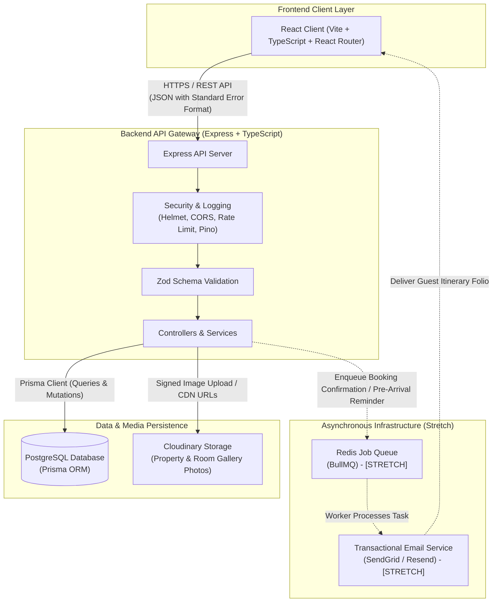

# System Architecture: The Bombay Reserve Full-Stack Platform

## 1. High-Level System Architecture Diagram



---

## 2. Core Architectural Components

### 1. React Client (`/client`)
- **Technology**: React 18, Vite, TypeScript, React Router v6, Tailwind CSS, Lucide icons.
- **Role**:
  - **Public & Guest Experience**: Browse 14 Mumbai boutique properties, search by neighborhood, check real-time date availability, complete multi-step room reservations with confirmed voucher code generation (`TBR-BOM-XXXXXX`), look up existing reservations, and submit bespoke event enquiries.
  - **Front-Desk Staff Portal**: Operational dashboard for today's expected check-ins and check-outs, fast reservation lookup by code/phone/name, one-click check-in and check-out status transitions, 14-day rolling occupancy grid, and enquiry pipeline triage.
- **Communication**: Communicates with the backend Express API via a typed fetch client with standardized error handling.

### 2. Express Backend API (`/server`)
- **Technology**: Node.js, Express, TypeScript, Zod, Pino structured logger, Helmet, CORS, Express Rate Limit.
- **Structural Layout**:
  - `src/app.ts`: Creates Express application, attaches security middleware (`helmet`, `cors`, `express-rate-limit`), request correlation logger (`pino-http`), exposes `GET /api/health`, mounts versioned routers, and registers the centralized `{ error: { code, message, details? } }` error handler. Exported for testing.
  - `src/server.ts`: Bootstrap entry point that binds `app.listen(PORT)` and logs startup status.
  - `src/routes/`: Express route declarations.
  - `src/controllers/`: HTTP request handlers and response formatting.
  - `src/services/`: Core domain logic (availability overlap checks, booking reference generation, pricing calculations).
  - `src/middleware/`: JWT authentication, RBAC authorization (`GUEST`, `STAFF`, `ADMIN`), Zod request validators, and error handler.
  - `src/schemas/`: Zod schemas validating bodies, queries, and route parameters.
  - `src/utils/`: Pino logger, custom typed AppErrors, and reference code generators.
  - `src/jobs/`: Background job interfaces for asynchronous stretch workflows.

### 3. PostgreSQL Database & Prisma ORM
- **Technology**: PostgreSQL with Prisma ORM.
- **Data Models**:
  - `User`: Guest, Staff, and Admin credentials (passwords hashed with `bcryptjs`).
  - `Property`: The 14 distinct Mumbai boutique hotel sanctuaries with rich neighbourhood provenance.
  - `RoomType`: 42 curated room categories with pricing in INR, bed configurations, and square footage.
  - `Room`: Physical room inventory instances and current occupancy status (`AVAILABLE`, `OCCUPIED`, `MAINTENANCE`).
  - `Booking` & `BookingItem`: Complete reservation records, guest contact info, date ranges, total amounts, and lifecycle states (`CONFIRMED`, `CHECKED_IN`, `CHECKED_OUT`, `CANCELLED`).
  - `Enquiry`: Bespoke event requests (Weddings, Corporate, Shoots, Private Dining) with triage states (`NEW`, `CONTACTED`, `QUOTED`, `CLOSED`).

### 4. Cloudinary Image Storage
- **Role**: Cloud object and image CDN storing high-resolution photography of the 14 boutique hotels, suites, architectural details, and guest amenities.

### 5. Redis Job Queue & Email Service (Stretch)
- **Redis Job Queue** (*Stretch*): Decouples long-running asynchronous background jobs from HTTP requests using a distributed Redis queue (e.g. BullMQ).
- **Email Service** (*Stretch*): Dispatches transactional emails including instant reservation confirmation folios with printable booking codes, 48-hour pre-arrival concierge preferences surveys, and staff notifications when bespoke event enquiries are submitted.

---

## 3. Standardized Error Contract

All endpoints adhere to a uniform JSON error structure:
```json
{
  "error": {
    "code": "STRING_IDENTIFIER",
    "message": "Human-readable explanation of error",
    "details": {}
  }
}
```
Standard codes: `VALIDATION_ERROR`, `UNAUTHORIZED`, `FORBIDDEN`, `NOT_FOUND`, `CONFLICT`, `RATE_LIMIT_EXCEEDED`, `INTERNAL_SERVER_ERROR`.
