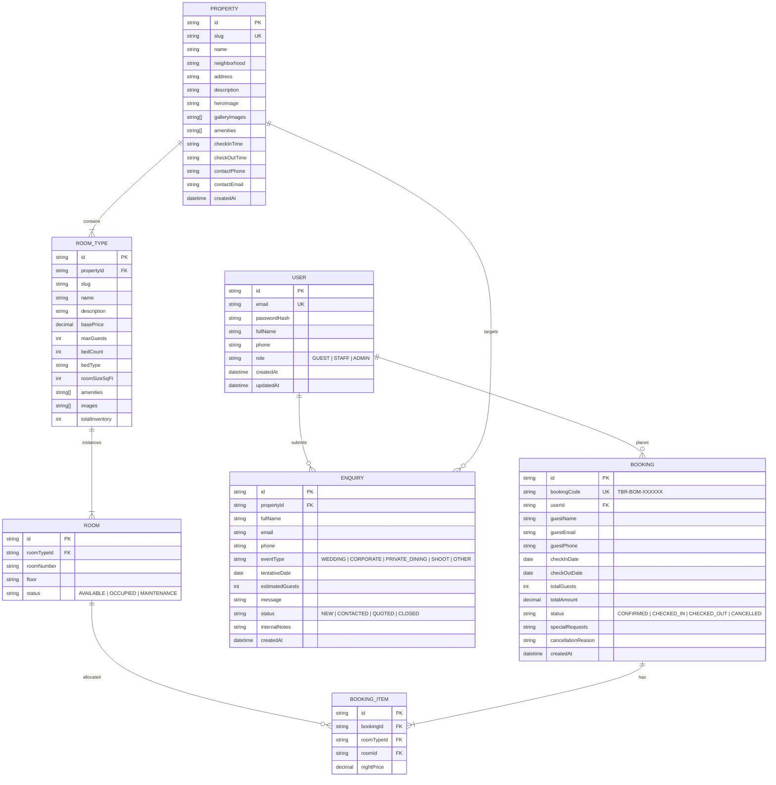

# Database ERD & Schema Catalog

## 1. Entity Relationship Diagram

---

## 2. The 14 Fictional Mumbai Boutique Properties

| # | Property Name | Slug | Precinct | Style & Provenance | Starting Rate |
|---|---|---|---|---|---|
| 1 | **The Colaba Colonial** | `the-colaba-colonial` | Colaba, South Mumbai | 1912 Victorian-Edwardian mansion steps from Gateway of India | &#8377;15,500 |
| 2 | **Marine Drive Bayview** | `marine-drive-bayview` | Marine Drive | 1930s Art Deco on Queen's Necklace promenade | &#8377;14,500 |
| 3 | **Kala Ghoda Art House** | `kala-ghoda-art-house` | Kala Ghoda | Atelier & rotating contemporary Indian art exhibition | &#8377;10,500 |
| 4 | **The Malabar Verandah** | `the-malabar-verandah` | Malabar Hill | Hanging Gardens botanical manor overlooking Back Bay | &#8377;14,000 |
| 5 | **Bandra Bohemian Villa**| `bandra-bohemian-villa` | Pali Hill, Bandra West | 1920s Indo-Portuguese bungalow with azulejo tiles | &#8377;12,500 |
| 6 | **Bandstand Ocean Mist** | `bandstand-ocean-mist` | Bandstand, Bandra West | Cliffside brutalist villa facing breaking ocean waves | &#8377;17,500 |
| 7 | **Juhu Palms Retreat** | `juhu-palms-retreat` | Juhu Beach | Beachside coconut palm bungalow with direct sand access | &#8377;13,500 |
| 8 | **Versova Coastal Sanctuary**| `versova-coastal-sanctuary`| Versova | Reclaimed dhow boat wood & Koli artisan community | &#8377;9,500 |
| 9 | **Worli Sea Face Glasshouse**| `worli-sea-face-glasshouse`| Worli Sea Face | Avant-garde glass pavilion facing Bandra-Worli Sea Link | &#8377;14,000 |
| 10| **Powai Lake Pavilions** | `powai-lake-pavilions` | Powai | Nordic timber-and-slate lakefront lodge with sauna | &#8377;11,000 |
| 11| **BKC Executive Boutique**| `bkc-executive-boutique` | Bandra Kurla Complex | Sleek Japanese minimalist corporate executive retreat | &#8377;13,000 |
| 12| **Fort Heritage Chambers**| `fort-heritage-chambers`| Fort Historic District | 19th-century Neo-Classical colonnade by Horniman Circle | &#8377;12,500 |
| 13| **Dadar Parsi Haven** | `dadar-parsi-haven` | Dadar Parsi Colony | Art Deco serenity in Mumbai's largest planned garden enclave | &#8377;9,500 |
| 14| **Girgaon Sunset Mansion**| `girgaon-sunset-mansion` | Girgaon Chowpatty | Retro coastal cultural woodwork and bay sunset views | &#8377;10,500 |
