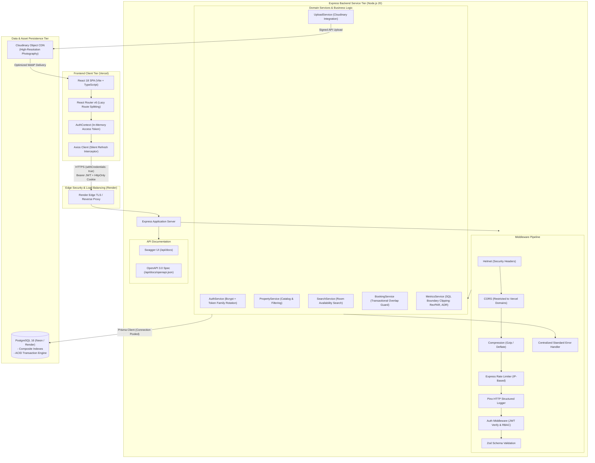
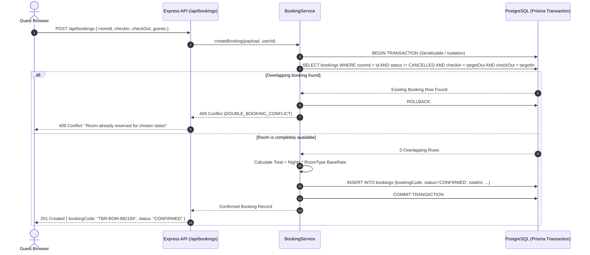
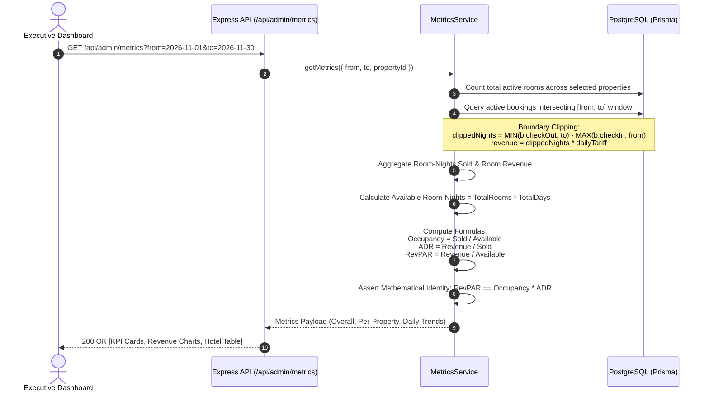

# System Architecture: The Bombay Reserve Full-Stack Platform

This document describes the end-to-end architecture, communication contracts, database topology, and security mechanisms of **The Bombay Reserve** luxury boutique hotel platform.

---

## 1. High-Level System Architecture



---

## 2. Core Architectural Components

### 1. Frontend Client Layer (`/client`)
- **Technology Stack**: React 18, Vite, TypeScript, Tailwind CSS, Lucide Icons, React Router v6.
- **Key Subsystems**:
  - **In-Memory Access Token**: Access JWTs are held exclusively in memory within `AuthContext` to prevent XSS credential exfiltration.
  - **Axios Silent Refresh Interceptor**: When an API call returns `401 Unauthorized`, an Axios interceptor catches the response, queues concurrent requests, hits `POST /api/auth/refresh` (delivering the browser's `httpOnly` cookie), receives a fresh access token, and transparently replays all queued calls without user disruption.
  - **Route Guards**: `<ProtectedRoute>` guards member reservations; `<AdminRoute>` guards executive operations, rejecting non-admin users with a 403 access banner.
  - **Performance Optimization**: Dynamic `React.lazy()` chunking across all 10 page routes, reducing initial payload to <85 kB gzip.

---

### 2. Backend API Gateway & Server (`/server`)
- **Technology Stack**: Node.js 20, Express 4, TypeScript, Prisma ORM, Zod, Pino, Helmet, CORS, Compression.
- **Key Subsystems**:
  - **Layered Middleware Pipeline**:
    1. `helmet`: Protects against clickjacking, sniffing, and cross-site injections.
    2. `cors`: Restricts cross-origin requests to verified Vercel production and preview domains with `credentials: true`.
    3. `compression`: Gzip/Deflate compression for fast JSON transmission.
    4. `express-rate-limit`: Shields authentication endpoints from brute-force attempts (10 req/15 min).
    5. `pino-http`: Structured JSON logging omitting sensitive credentials.
    6. `validateBody` / `validateQuery`: Strict runtime validation via Zod schemas.
    7. `errorHandler`: Translates all domain errors into uniform JSON contracts:
       ```json
       { "error": { "code": "STRING_CODE", "message": "Human readable detail" } }
       ```
  - **Interactive Documentation**: Swagger UI served live at `/api/docs` with raw spec at `/api/docs/openapi.json`.

---

### 3. Data Tier & Relational Schema (PostgreSQL + Prisma)
- **Data Models**:
  - `User`: Admin, Staff, and Guest accounts with bcrypt password hashing ($10\times$ work factor).
  - `RefreshToken`: Cryptographic SHA-256 token hashes with rotation lineage and automatic family revocation upon reuse detection.
  - `Property`: The 14 curated Mumbai boutique properties with neighborhood provenance.
  - `RoomType`: 42 curated room categories with INR tariffs, bed configurations, and capacity rules.
  - `Room`: Physical room inventory instances with availability states (`AVAILABLE`, `OCCUPIED`, `MAINTENANCE`).
  - `Booking`: Reservation contracts with check-in/out dates, guest counts, total INR tariffs, and lifecycle states (`CONFIRMED`, `CHECKED_IN`, `CHECKED_OUT`, `CANCELLED`).
  - `Enquiry`: Bespoke event, shoot, and dining enquiries with triage pipeline status.
- **Composite Indexes**:
  - `@@index([status, checkIn, checkOut])` on `Booking` for sub-10ms overlap searches.
  - `@@index([propertyId])` and `@@index([roomTypeId])` for relational joins.
  - `@@index([email])` on `User` for rapid login lookups.

---

## 3. Core Sequence Diagrams

### A. Authentication & Refresh Token Rotation

```mermaid
sequenceDiagram
    autonumber
    actor Guest as Guest Browser
    participant API as Express API (/api/auth)
    participant AuthSvc as AuthService
    participant DB as PostgreSQL (Prisma)

    Guest->>API: POST /login { email, password }
    API->>AuthSvc: login(credentials)
    AuthSvc->>DB: Find User by Email
    DB-->>AuthSvc: User Record + Password Hash
    AuthSvc->>AuthSvc: Verify Bcrypt Hash
    AuthSvc->>AuthSvc: Generate Access JWT (15m) & Refresh Token (7d)
    AuthSvc->>DB: Store SHA-256 Hashed Refresh Token
    AuthSvc-->>API: { user, accessToken, refreshToken }
    API-->>Guest: 200 OK + Set-Cookie: refreshToken (HttpOnly; Secure; SameSite=None)

    Note over Guest, API: 15 minutes elapse; Access JWT expires
    Guest->>API: GET /api/bookings (Access JWT Expired)
    API-->>Guest: 401 Unauthorized

    Guest->>API: POST /api/auth/refresh (Cookie Auto-Attached)
    API->>AuthSvc: refresh(oldToken)
    AuthSvc->>DB: Lookup Token Hash
    alt Token was already revoked / reused
        AuthSvc->>DB: Revoke entire token family (Security Breach)
        AuthSvc-->>API: 401 Unauthorized (Reuse Detected)
    else Token is valid
        AuthSvc->>DB: Mark old token REVOKED
        AuthSvc->>DB: Issue & Store new rotated token
        AuthSvc-->>API: { accessToken, newRefreshToken }
        API-->>Guest: 200 OK + Set-Cookie: newRefreshToken
        Guest->>API: Replay GET /api/bookings (with new Access Token)
        API-->>Guest: 200 OK [Bookings Payload]
    end
```

---

### B. Transactional Room Booking & Overlap Guard



---

### C. Executive Dashboard Metrics Engine (SQL Boundary Clipping)


